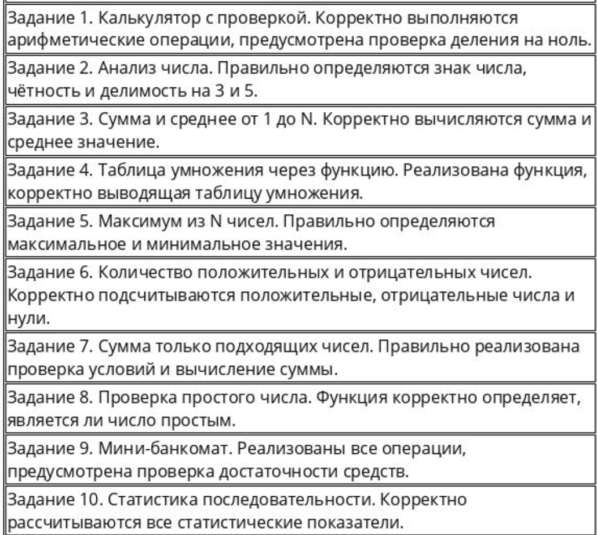

# HSE Golang Project

Итоговое задание 1-го модуля по предмету *Семинар наставника*

Список заданий:



## Структура проекта

Каждое задание находится в отдельной директории

```text
hse-golang-project/
├── go.mod
├── README.md
├── task-01/
│   └── main.go
├── task-02/
│   └── main.go
├── task-03/
│   └── main.go
├── task-04/
│   └── main.go
├── task-05/
│   └── main.go
├── task-06/
│   └── main.go
├── task-07/
│   └── main.go
├── task-08/
│   └── main.go
├── task-09/
│   └── main.go
└── task-10/
    └── main.go
```


## Требования

- Установленный Go
- Терминал для запуска консольных программ

## Установка и запуск

**1. Клонировать репозиторий**

```bash
git clone https://github.com/KirillovAV1/hse-golang-project.git
```

**2. Перейти в директорию проекта**

```bash
cd hse-golang-project
```

**3. Запустить необходимое задание**


```bash
go run ./task-01
```
